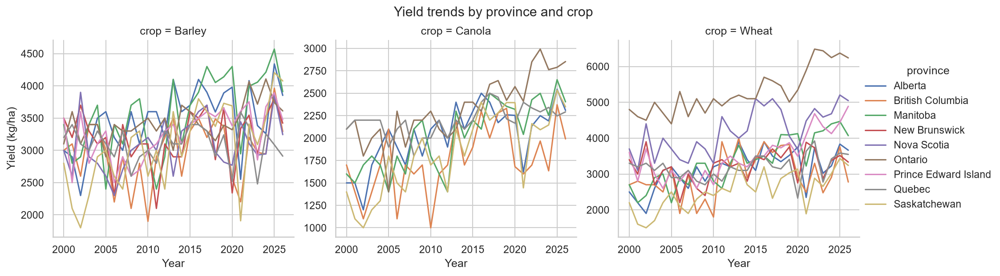
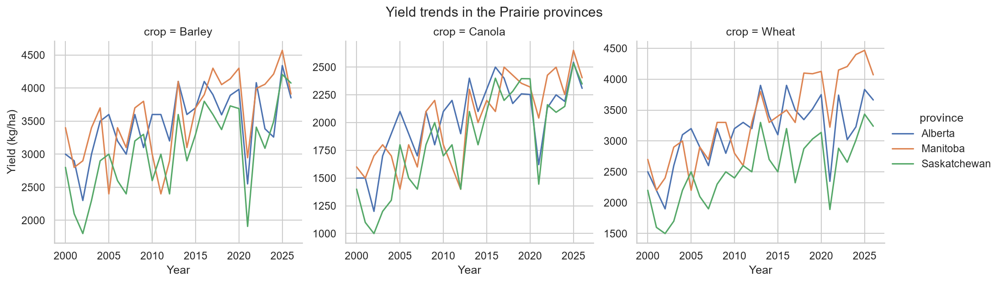
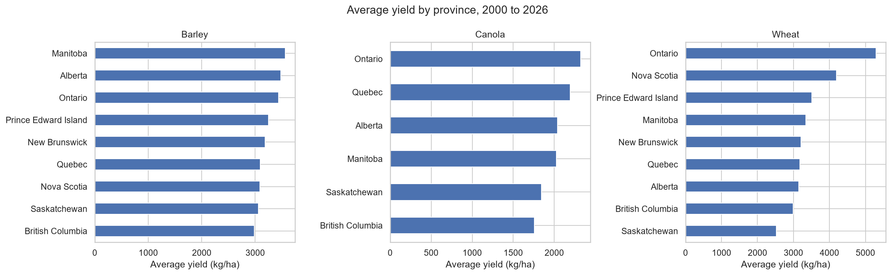
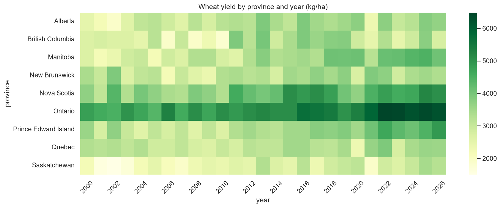
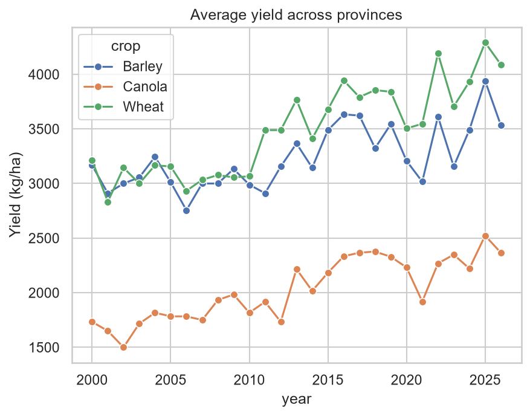
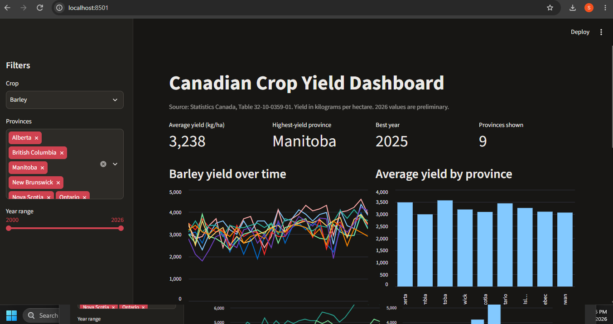

# Canadian Crop Yield Analysis Dashboard

## About the project
This project analyzes open Statistics Canada data (Table 32-10-0359-01) to
understand how wheat, canola, and barley yields have changed across Canadian
provinces from 2000 to 2026. It covers the full analyst workflow: cleaning the
raw data in Python, storing it in a SQL database, answering questions with SQL
queries, visualizing trends, and presenting the results in an interactive
Streamlit dashboard.

## Question
How have wheat, canola, and barley yields changed over time across
Canadian provinces, and which provinces perform best?

## Key findings
- Between 2000-2004 and 2021-2025, average yields rose 34.0% for canola,
  28.1% for wheat, and 12.0% for barley (simple average across provinces).
- Ontario ranks first for wheat and canola by average yield per hectare.
  Manitoba ranks first for barley.
- Saskatchewan has the lowest average wheat yield, but yield per hectare is
  not total production.
- In 2021, average yields across the three Prairie provinces fell 38.1% for
  barley, 26.7% for canola, and 32.3% for wheat compared with 2020. The
  all-province average hid this for wheat (+1.2%) because Ontario and the
  eastern provinces offset the western decline.
- 2002 was the lowest year for all three crops in the Prairie provinces.

## Data source
Statistics Canada, Table 32-10-0359-01: Estimated areas, yield, production,
average farm price and total farm value of principal field crops
(downloaded October 30, 2026).

## Tools
Python (pandas, matplotlib, seaborn), SQL (SQLite), Streamlit, Git

## Methodology
1. **Explore:** inspected the raw file (columns, crops, units, regions, status flags).
2. **Clean:** kept kilograms per hectare, three crops, and ten provinces; removed
   national and regional totals; dropped missing and zero yields; excluded series
   with fewer than 15 years of data.
3. **Store:** loaded the clean data into a SQLite database.
4. **Query:** wrote five SQL queries (average yield by province, year-over-year
   change, top 3 provinces per crop, best and worst years, 5-year moving average).
5. **Visualize:** built charts of trends, rankings, and a yield heatmap.
6. **Present:** built an interactive Streamlit dashboard with filters for crop,
   province, and year range.

## Charts

### Yield trends by province

### Prairie provinces

### Average yield by province

### Wheat yield by province and year

### Average yield across provinces

## Dashboard

The Streamlit dashboard lets you filter by crop, province, and year range, and
shows summary numbers, a yield trend chart, a province comparison, and the
underlying data.

## How to run
    git clone https://github.com/salonipatel152719-jpg/canada-crop-yield-analysis.git
    cd canada-crop-yield-analysis
    python -m venv venv
    venv\Scripts\activate
    pip install -r requirements.txt
    streamlit run app/app.py

## Data notes
- Yield is measured in kilograms per hectare.
- 2026 values are preliminary Statistics Canada estimates and may be revised.
- Rows with no reported yield and zero-yield rows were removed.
- Crop-province series with fewer than 15 years of data were excluded so
  averages are comparable.
- Rankings are based on yield per hectare, not total production.

## Limitations
- Averages are simple means across provinces, not weighted by acreage or production.
- Yield per hectare does not reflect total production.
- 2026 values are preliminary and may be revised.
- Weather, soil, and farming practices are not included, so the analysis shows
  when yields dropped but cannot confirm why.

## Next steps
- Add weather data (Environment and Climate Change Canada) to test whether
  rainfall and temperature explain the 2002 and 2021 Prairie yield drops.
- Build a yield forecasting model.

## Author
Saloni Patel